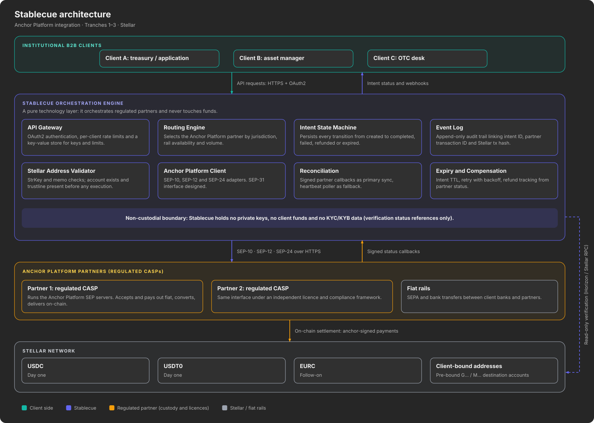
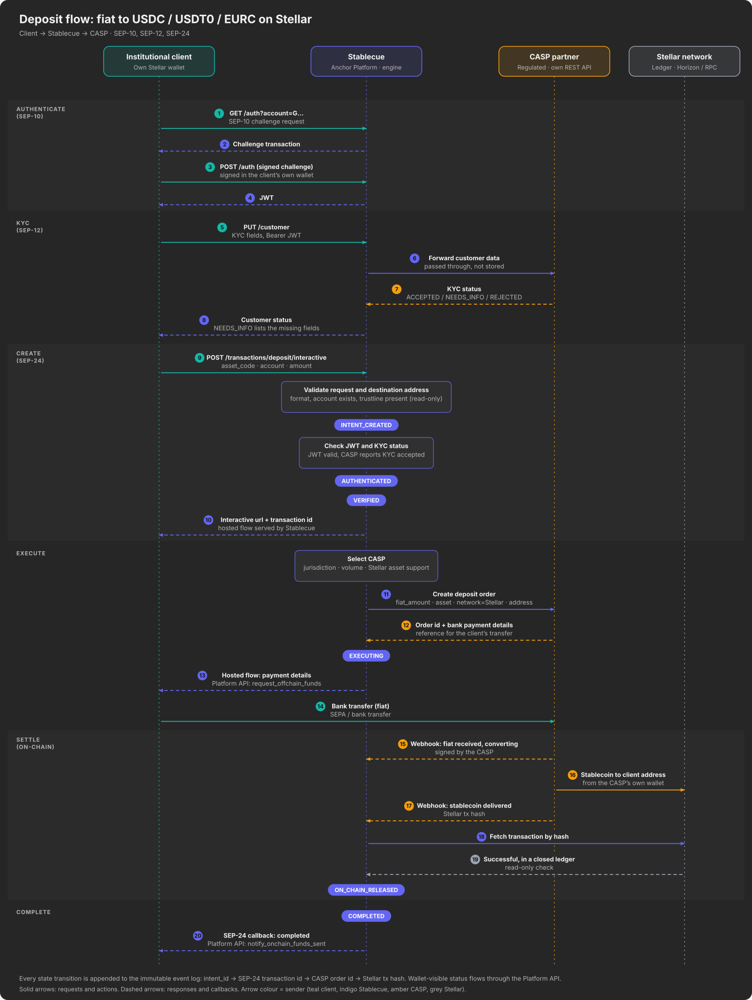
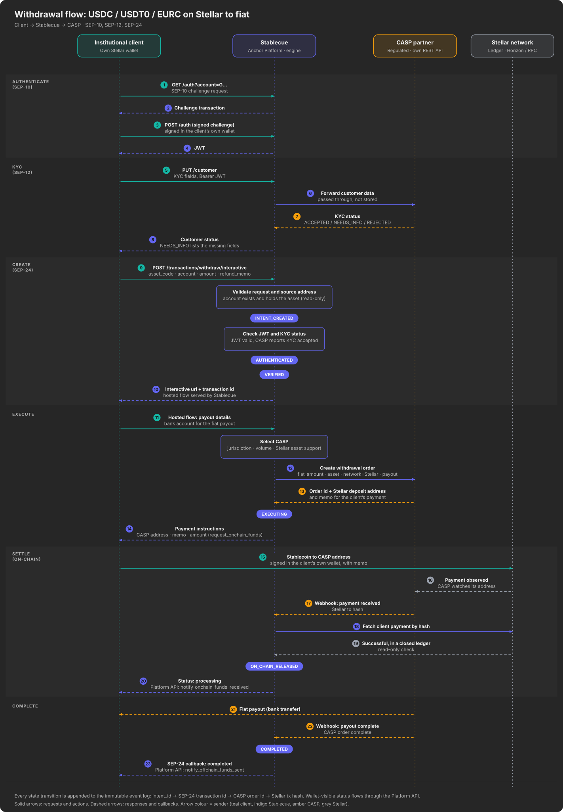
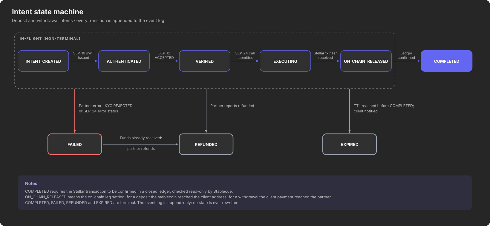

# Stablecue Technical Architecture

**Stellar Anchor Platform integration track · Tranches 1–3 · Stellar-specific build plan**

---

## 1. Purpose and Scope

This document defines the technical architecture for Stablecue's Stellar integration. It covers what will be built across Tranches 1 to 3 only. Business model, marketing and other non-technical deliverables are addressed elsewhere in the submission.

Stablecue is the layer between institutional clients and regulated partners (CASPs). It runs the Stellar Anchor Platform, so clients and wallets reach regulated fiat rails through standard SEPs, and it integrates each CASP's own API behind it. The flow is **Client → Stablecue → CASP**. A CASP needs no SEP or Anchor Platform integration: it executes the fiat and stablecoin legs, including sending and receiving on Stellar from its own wallets, within its own licence and compliance framework.

| | |
|---|---|
| **Integration target** | Stellar Anchor Platform, operated by Stablecue (SEP-1, SEP-10, SEP-12 and SEP-24; SEP-31 designed) |
| **Execution** | Regulated CASP partners, integrated through their own REST APIs |
| **Network** | Stellar Testnet for Tranche 3 deployment, with a defined Mainnet path |
| **Assets** | USDC and USDT0 on day one, EURC as a follow-on. USDT0 is the omnichain form of USDT on Stellar |

---

## 2. Stablecue as Anchor Platform Operator

Stablecue deploys the Stellar Anchor Platform and implements its business server. Clients and wallets talk to Stablecue using standard SEPs, so they integrate once with a Stellar-native interface and never deal with a CASP directly.

### 2.1 Anchor Platform components

| Component | Provided by | Role in Stablecue |
|-----------|-------------|-------------------|
| **SEP server** | Anchor Platform | Serves the SEP endpoints to wallets and clients |
| **Platform API and event service** | Anchor Platform | The engine updates transaction status here, and the platform notifies wallets by signed callback |
| **Business server** | Stablecue | The orchestration engine. It implements the platform's customer callbacks (SEP-12) and drives each transaction through the Platform API |
| **Hosted interactive flow** | Stablecue | SEP-24 pages for amounts, KYC hand-off and payment instructions. The Anchor Platform has no white-label UI |
| **Stellar Observer and custody server** | Anchor Platform | Not used for client payments, which go to and from CASP wallets. The engine verifies transactions on the ledger itself and reports them to the Platform API |

Because client payments on a withdrawal go to the CASP's address, the Anchor Platform's deposit-info generation is set to business-provided: the engine supplies the CASP's Stellar address and memo through the Platform API.

### 2.2 SEPs used

| SEP | Role of Stablecue | Scope |
|-----|-------------------|-------|
| SEP-1 | Hosts `stellar.toml`: `WEB_AUTH_ENDPOINT`, `TRANSFER_SERVER_SEP0024`, `KYC_SERVER` and the Stablecue `SIGNING_KEY` | Tranches 1–3 |
| SEP-10 | Issues the authentication challenge. The client signs it in their own wallet and Stablecue issues a JWT | Tranches 1–3 |
| SEP-12 | Serves the customer endpoints. KYC data is passed through to the CASP | Tranches 1–3 |
| SEP-24 | Serves the interactive deposit and withdrawal endpoints and the hosted flow | Tranches 1–3 |
| SEP-31 | Cross-border payment interface. Designed in Tranche 1, not built in Tranches 2–3 | Design only |
| SEP-38 | Firm quotes for non-equivalent pairs such as EUR to USDC | Follow-on |

Spec versions (SEP-24 is currently at 3.x, SEP-12 at 1.x) and the Anchor Platform version are pinned in Tranche 1.

---

## 3. System Architecture Overview



### 3.1 Components

| Component | Responsibility |
|-----------|----------------|
| **SEP Server and Hosted Flow** | Anchor Platform endpoints and the Stablecue-built interactive pages |
| **SEP Signing Key** | Signs SEP-10 challenges and callbacks. Never holds funds |
| **API Gateway** | REST API for institutional clients: OAuth2, per-client rate limiting, key-value store for keys and limits |
| **Routing Engine** | Selects the CASP by jurisdiction, volume, rail availability and Stellar asset support. Built to select across several CASPs, with one integrated in this grant |
| **Intent State Machine** | Persists every intent transition (section 7) |
| **Event Log** | Append-only audit trail linking intent ID, SEP-24 transaction ID, CASP order ID and Stellar transaction hash |
| **Stellar Address Validator** | StrKey format, memo, account exists and trustline present, checked before any execution |
| **CASP Adapters** | One adapter per CASP, mapping its REST API and webhooks to Stablecue intents (section 6.4) |
| **Reconciliation** | Signed CASP webhooks as the primary sync, with a heartbeat poller as fallback |
| **Expiry and Compensation** | Intent TTL, retry with exponential backoff and refund tracking |

### 3.2 Authentication, signing and custody model

- **Client keys stay with the client.** Client wallets sign SEP-10 challenges and, on a withdrawal, the payment to the CASP.
- **Stablecue's own key.** Stablecue holds a SEP signing key used only to sign SEP-10 challenges and callbacks. That account holds no funds.
- **On-chain legs.** The CASP sends the asset on a deposit and receives it on a withdrawal, from its own wallets.
- **Ledger access.** Stablecue reads the Stellar network (Horizon or Stellar RPC) to verify transactions and never submits them.
- **Callbacks.** CASP webhooks are accepted only after signature and freshness checks.
- **Account types.** Classic `G…` and muxed `M…` accounts are supported. Soroban contract accounts (`C…`) would require SEP-45 and are out of scope.
- **Entry points.** Stellar wallets and clients use the SEPs. Institutional clients without a wallet integration can use the REST API (section 6.2). Both create the same intent.

---

## 4. Architecture by Tranche

### Tranche 1: Architecture and Foundation (Approved)

**Objective**: Define the Stablecue engine and Anchor Platform architecture, design the CASP adapter contract and provision the development environment.

**Technical deliverables**:

1. **Engine architecture and API design**
   - Anchor Platform deployment design: SEP server, Platform API, event service and the business-server callbacks
   - Stablecue REST API gateway specification (OAuth2, rate limiting, request and response schemas)
   - CASP adapter interface design: one contract for partner REST APIs, webhooks and capability flags
   - Intent state machine definition (section 7)
   - Event log schema (append-only, read-only audit trail)

2. **Partner integration groundwork**
   - CASP API mapping per partner: orders, KYC status, deposit addresses and webhooks
   - Anchor Platform configuration: `stellar.toml`, asset definitions and business-provided deposit information
   - Credential management: CASP API keys, webhook verification keys and custody of the SEP signing key
   - Webhook endpoint design for CASP status updates

3. **Dev environment and hosting setup**
   - Isolated dev and staging environments with an Anchor Platform sandbox and CASP sandbox access
   - CI/CD pipeline for engine builds
   - Logging and error tracking infrastructure

**Stellar-specific decisions made in Tranche 1**:
- Which CASP to integrate first
- Anchor Platform version and SEP versions in use
- Stellar address validation rules (StrKey, memo handling, trustline checks)
- Asset identifier configuration for USDC, USDT0 and EURC on Stellar Testnet

---

### Tranche 2: MVP Core Engine Build

**Objective**: Build the core Stablecue orchestration engine, the Anchor Platform integration and the first CASP adapter.

**Technical deliverables**:

1. **Core engine build: intent flow, state machine, API**
   - Intent creation from SEP-24 interactive requests and from the REST API: asset (USDC, USDT0 or EURC), fiat amount and Stellar address
   - Authentication: SEP-10 JWT validation for wallets, OAuth2 for REST clients
   - Routing logic: selects the CASP by jurisdiction, volume, rail availability and Stellar asset support, over the common adapter interface. It supports several CASPs, although one is integrated in this grant
   - State machine: persists intent transitions to the append-only event log
   - Client REST API: status queries, intent cancellation and transaction history

2. **Anchor Platform and CASP integration**
   - SEP-10 and SEP-24 configuration, and the SEP-12 customer callbacks, which forward KYC data to the CASP
   - Hosted interactive flow: amounts, KYC hand-off and payment instructions
   - Platform API integration: the engine reports CASP progress as SEP-24 status updates
   - Adapter for the first CASP: create order, order status, KYC status and signed webhooks
   - Error handling: maps CASP errors and statuses to intent states and SEP-24 statuses
   - Retry logic: exponential backoff for transient CASP failures

3. **API documentation for client integrations**
   - OpenAPI specification for the Stablecue REST endpoints
   - Integration guide for B2B clients and wallets: `stellar.toml` discovery, SEP-10 authentication, binding Stellar addresses, submitting intents and handling callbacks

**Stellar-specific decisions made in Tranche 2**:
- SEP-12 flow: how customer data is forwarded to the CASP and how KYC status is returned
- SEP-24 flow: how the hosted pages collect amounts and payout details and hand them to the CASP
- How the engine reports CASP progress to the Platform API
- Address validation: pre-binding and checking Stellar addresses before any execution

---

### Tranche 3: Stellar Integration (Testnet)

**Objective**: Complete the Stellar-specific integration (USDC, USDT0 and EURC flows, address binding, on-chain verification and reliability logic), deployed and tested on Stellar Testnet.

**Technical deliverables**:

1. **Stellar integration**
   - Deposit and withdrawal orchestration for USDC, USDT0 and EURC through the CASP adapter
   - Stellar address binding: clients pre-bind Stellar addresses and the engine validates format, account existence and trustline before execution
   - On-chain verification: the engine verifies every CASP-reported Stellar transaction on the ledger, read-only, before advancing the intent
   - Withdrawal payments: the client pays the CASP's Stellar address with a memo, and the engine detects it from the CASP webhook and the ledger
   - Transaction linking: intent ID, SEP-24 transaction ID, CASP order ID and Stellar transaction hash (complete paper trail)
   - Asset configuration: identifiers for USDC, USDT0 and EURC on Stellar Testnet, with EURC enabled after day one

2. **Reliability logic**
   - Reconciliation: webhook-driven status sync from the CASP plus a background heartbeat poller as fallback
   - Fallback checks: periodic synchronisation of internal state with the CASP's actual order status
   - Refund tracking: when execution fails after funds were received, the CASP's refund is tracked to completion
   - Intent expiry: TTL on all intents, with automatic expiry and client notification for incomplete transactions

3. **API documentation**
   - Updated OpenAPI specification including Stellar-specific endpoints (address binding, on-chain status)
   - Callback documentation for wallet callbacks and CASP webhooks

4. **Stellar testnet testing and monitoring**
   - End-to-end testnet deployment with the Anchor Platform and a CASP sandbox (or a simulated CASP adapter where the partner has no Stellar Testnet support)
   - USDC, USDT0 and EURC delivery and receipt test flows
   - Reconciliation and refund path testing
   - Monitoring dashboards for intent success and failure rates

**Stellar-specific decisions made in Tranche 3**:
- Which Stellar assets (USDC, USDT0 and EURC) and their identifiers: issuer account for classic assets, contract ID for Soroban tokens
- Memo handling for transaction identification
- On-chain confirmation rule: a successful transaction in a closed ledger
- Trustline policy: intents are blocked until the destination trustline exists
- Testnet and Mainnet configuration separation

---

## 5. Stellar Transaction Flows

In both flows the client or wallet talks only to Stablecue. Stablecue's hosted SEP-24 pages guide the client, and the engine drives the CASP through its REST API. Intents created through the REST API join the flow at INTENT_CREATED.

### 5.1 Deposit (fiat to USDC, USDT0 or EURC on Stellar)



Notes:
- The destination account must exist and hold a trustline for the asset. Stablecue checks this before creating the intent, because the CASP's delivery would otherwise fail.
- The CASP must support Stellar as a delivery network for the chosen asset. The routing engine only selects CASPs that do.
- Stablecue verifies the Stellar transaction itself and then reports completion to the Platform API. The wallet is never told "completed" on the CASP's word alone.

### 5.2 Withdrawal (USDC, USDT0 or EURC on Stellar to fiat)



Notes:
- The CASP supplies its Stellar deposit address and memo. The engine passes them to the wallet through the Platform API, and the wallet pays the CASP directly. Stablecue never receives the funds, so the Stellar Observer is not used for these payments.
- The wallet's `refund_memo` is passed to the CASP so that a refund of the on-chain payment can be matched to the transaction.

---

## 6. API Contracts

### 6.1 Wallets and clients to Stablecue (SEP endpoints)

Served by the Anchor Platform. Locations are published in Stablecue's `stellar.toml`.

| Endpoint | SEP | Purpose |
|----------|-----|---------|
| `GET /.well-known/stellar.toml` | SEP-1 | Discovery |
| `GET /auth`, `POST /auth` | SEP-10 | Challenge, then signed challenge in exchange for a JWT |
| `PUT /customer`, `GET /customer`, `DELETE /customer` | SEP-12 | KYC data, passed through to the CASP |
| `POST /transactions/deposit/interactive` | SEP-24 | Start a deposit |
| `POST /transactions/withdraw/interactive` | SEP-24 | Start a withdrawal |
| `GET /transaction`, `GET /transactions` | SEP-24 | Transaction status and history |

**SEP-10**:
```
GET /auth?account=G…[&memo=<id memo>]
→ { "transaction": "<challenge XDR>", "network_passphrase": "…" }

POST /auth
{ "transaction": "<challenge signed in the client wallet>" }
→ { "token": "<JWT>" }
```
The memo is optional, must be of type `id` and can only be used with a `G…` account.

**SEP-24** (a withdrawal uses `/transactions/withdraw/interactive` and adds `refund_memo`):
```
POST /transactions/deposit/interactive
Authorization: Bearer <JWT>
{ "asset_code": "USDC", "account": "G…", "amount": "100000.00" }
→ { "type": "interactive_customer_info_needed", "url": "https://…", "id": "…" }
```
Claimable balances are not used in Tranches 1–3. The destination account must hold a trustline.

Status changes reach the wallet through its `on_change_callback`, signed with the Stablecue SEP signing key, and are available by polling `GET /transaction?id=`.

### 6.2 Institutional clients to Stablecue (REST)

| Endpoint | Purpose |
|----------|---------|
| `POST /v1/intents` | Create a deposit or withdrawal intent |
| `GET /v1/intents/{intent_id}` | Get intent status |
| `POST /v1/intents/{intent_id}/cancel` | Cancel an intent that has not started execution |
| `GET /v1/intents` | Transaction history |

**Create Intent**:
```
POST /v1/intents
{
  "direction": "deposit | withdrawal",
  "fiat_amount": "decimal",
  "fiat_currency": "EUR | USD",
  "stellar_asset": "USDC | USDT0 | EURC",
  "destination_stellar_address": "G… (deposit)",
  "source_stellar_address": "G… (withdrawal)",
  "memo": "optional"
}
```
Returns `intent_id`, `state` and `expires_at`. Once the CASP order exists, `GET /v1/intents/{intent_id}` also returns `payment_instructions`: bank details for a deposit, or the CASP's Stellar address and memo for a withdrawal. It also returns the partner order references, the Stellar transaction hash (when available) and timestamps.

### 6.3 Platform API and business-server callbacks

The engine acts as the business server, and the two sides of that contract are:

- **Callbacks from the Anchor Platform to the engine**: customer requests (`GET`, `PUT` and `DELETE /customer`), which the engine forwards to the CASP's KYC API.
- **Platform API calls from the engine to the Anchor Platform** (JSON-RPC), which move the SEP-24 transaction through its statuses.

### 6.4 CASP adapter contract

Each CASP has its own REST API. The adapter hides the differences behind one contract:

| Operation | Purpose |
|-----------|---------|
| `capabilities()` | Supported assets and networks, jurisdictions and limits |
| `submit_customer()`, `get_kyc_status()` | Pass customer data through and read the KYC status |
| `create_order()` | Create a deposit or withdrawal order. Deposit: destination Stellar address. Withdrawal: payout details. Returns the order ID and payment instructions |
| `get_order()` | Order status, Stellar transaction hash and refund details |
| `cancel_order()` | Cancel an order that has not started |
| `verify_webhook()` | Signature and freshness check for the CASP's webhook scheme |

CASP webhooks arrive at `POST /webhooks/casp/{casp_id}`. Each CASP's payload and signature scheme differ, so the adapter verifies the signature and timestamp and normalises the event before it reaches the state machine. Webhooks without a valid signature are rejected.

### 6.5 Status mapping

| CASP event | Intent state | Platform API call, resulting SEP-24 status |
|------------|--------------|--------------------------------------------|
| Deposit order created, waiting for the client's fiat | EXECUTING | `request_offchain_funds`, `pending_user_transfer_start` |
| Withdrawal order created, waiting for the client's stablecoin | EXECUTING | `request_onchain_funds`, `pending_user_transfer_start` |
| Deposit: fiat received, converting | EXECUTING | `notify_offchain_funds_received`, `pending_anchor` |
| Deposit: stablecoin delivered and verified on the ledger | ON_CHAIN_RELEASED, then COMPLETED | `notify_onchain_funds_sent`, `completed` |
| Withdrawal: client payment received and verified on the ledger | ON_CHAIN_RELEASED | `notify_onchain_funds_received`, `pending_anchor` |
| Withdrawal: fiat payout complete | COMPLETED | `notify_offchain_funds_sent`, `completed` |
| Trustline missing at delivery time | EXECUTING | `request_trust`, `pending_trust` |
| Refund issued | REFUNDED | `notify_refund_sent`, `refunded` |
| Order expired | EXPIRED | Expiry update, `expired` |
| CASP error or KYC rejected | FAILED | Error update, `error` |

---

## 7. State Machine and Event Log



### Intent states

| State | Description | Trigger |
|-------|-------------|---------|
| INTENT_CREATED | Request accepted and validated | SEP-24 interactive request or `POST /v1/intents` |
| AUTHENTICATED | Client identity confirmed and bound to the intent | SEP-10 JWT (or OAuth2 token) validated |
| VERIFIED | KYC confirmed by the CASP | CASP reports the client's KYC as accepted |
| EXECUTING | The CASP is processing the fiat and on-chain legs | CASP order created |
| ON_CHAIN_RELEASED | The Stellar leg is done. Deposit: the asset reached the client address. Withdrawal: the client payment reached the CASP | CASP reports it with a transaction hash, and the ledger check passes |
| COMPLETED | The CASP order is complete | CASP reports completion (withdrawal: fiat payout done) |
| FAILED | Execution failed | CASP error, KYC rejected or validation failure |
| REFUNDED | The CASP refunded funds it had received | CASP reports a refund |
| EXPIRED | TTL reached without completion | Internal timer |

Stellar closes a ledger roughly every five seconds and finality is deterministic, so there is no confirmation depth to configure: a successful transaction in a closed ledger is final.

### Event log schema (append-only, immutable)

```json
{
  "event_id": "uuid",
  "intent_id": "uuid",
  "from_state": "string",
  "to_state": "string",
  "trigger": "string",
  "sep24_transaction_id": "optional string",
  "casp_order_id": "optional string",
  "stellar_transaction_hash": "optional string",
  "timestamp": "ISO8601",
  "metadata": "optional object"
}
```

---

## 8. Reliability and Reconciliation

### 8.1 Webhook-driven primary sync

CASPs send signed webhooks whenever an order changes status. The adapter verifies each one, the engine updates the intent state machine, and the Platform API call in section 6.5 keeps the wallet's SEP-24 status in step.

### 8.2 Heartbeat poller fallback

If webhooks are missed or delayed, a background poller calls the CASP's order status operation at configurable intervals to detect state divergence. Transient failures are retried with exponential backoff.

### 8.3 Compensation

Refunds are issued by the CASP. Stablecue's role is to create the conditions for a clean refund and to track it to REFUNDED.

| Failure point | CASP behaviour | Stablecue action |
|---------------|----------------|------------------|
| Deposit: fiat received, asset not delivered | CASP refunds the fiat off-chain | Track to REFUNDED, report `refunded` to the wallet and notify the client |
| Withdrawal: client payment received, payout fails | CASP returns the stablecoin to the client's account, matched by the `refund_memo` | Track to REFUNDED, report `refunded` to the wallet and notify the client |
| Execution fails before any funds move | None | Mark FAILED and notify the client |
| Asset delivered on-chain, later disputed | Clawback only if the issuer has enabled it | Not relied upon; handled manually with the CASP |

### 8.4 Intent TTL

All intents have an expiration timestamp, never later than the CASP order's expiry. The same deadline is shown to the wallet as the SEP-24 `user_action_required_by` time. Intents not reaching COMPLETED within the window are automatically expired and the client is notified.

---

## 9. Onchain Footprint and Attribution

For SCF metric tracking, every transaction routed through Stablecue produces:

1. **Stellar transaction hash**: recorded in the event log and linked to the intent ID
2. **Asset**: USDC, USDT0 or EURC on Stellar (issuer account or contract ID configured per network)
3. **Client address**: the bound destination (deposit) or source (withdrawal) Stellar address, and memo where used
4. **SEP-24 transaction ID and CASP order ID**: link the off-chain fiat leg to the on-chain stablecoin leg

These data points allow attribution of TPV and volume to Stablecue's integration for final-tranche metric reporting.

---

## 10. Security Boundaries

- **No custody**: Stablecue never holds client funds or client keys. Client payments move directly between the client wallet and the CASP.
- **Limited signing**: Stablecue's own key signs SEP-10 challenges and callbacks only, and that account holds no funds. Clients sign their own challenges and withdrawal payments, and CASPs send and receive from their own wallets.
- **Read-only ledger access**: Stablecue only reads the Stellar network to verify transactions.
- **Authenticated webhooks**: CASP webhooks are accepted only after signature and freshness checks.
- **KYC data**: customer data is processed in transit to the CASP and stored by the CASP. Stablecue retains only verification status references.
- **Authentication**: SEP-10 JWTs for wallets, OAuth2 with scoped permissions for REST clients.
- **Rate limiting**: per-client API rate limits to prevent abuse.
